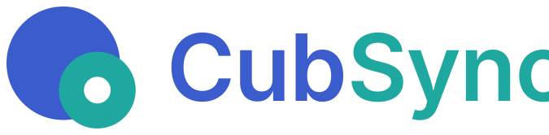

**[English](#english)** · **[中文](#中文)**

---

## English

The CubSync project site, served by GitHub Pages at <https://cubsync.github.io/>.

### Files

```
index.html          the landing page — hand-written, bilingual, no build step
demo/index.html     the two-end GUI prototype — copied from the main project;
                    self-contained, no external requests
assets/             favicon, apple-touch-icon, lockup, social preview
favicon.ico         fallback for pages that do not declare an icon
LICENSE             Apache-2.0, identical to the main repository's
NOTICE              scope, brand-asset reservation, third-party status
.nojekyll           serve the files as they are, no Jekyll
```

Everything here is static — no build step, no framework, no dependency.

### Language

`index.html` carries both languages in the markup and switches with CSS
(`html[data-lang]` hides the other set). No translation files, no fetch, no
flash of the wrong language: the resolver runs inline in `<head>`, before
anything is painted.

Resolution order:

1. `?lang=zh` / `?lang=en` in the URL — explicit, and shareable
2. the previous choice, in `localStorage`
3. the browser's language (`navigator.languages[0]`, `zh*` → Chinese)
4. English

Chinese is the default in the markup, so the page is correct with JavaScript
disabled. The switcher is the fixed control in the top-right corner; it writes
the choice back to `localStorage` and to the URL with `history.replaceState`.

Two languages is the current scope. A third one is a new entry in the `META`
map plus another `lang-xx` set — the mechanism does not need to change.

The prototype under `demo/` is deliberately **not** localised: it is the design
document, and its screen text is Chinese. See NOTICE §4.

### License

The site is Apache-2.0, the same license as the main repository, and `LICENSE`
is copied from there verbatim — keep the two in step if either is ever amended.

Apache-2.0 does **not** cover the brand: the CubSync name, the logo, the
organisation mark and the application icons are brand assets with all rights
reserved. That reservation, the third-party status (nothing third-party), and
the prototype's status are stated in `NOTICE`.

One trap: these two files are extension-less, which is the Apache convention and
what lets GitHub recognise them, but GitHub Pages serves those names as
`application/octet-stream`. A link to `/LICENSE` therefore **downloads** instead
of rendering, and Pages does not allow custom headers to change that. The footer
links to the repository's rendered view (`/blob/main/...`) for that reason —
point new links there, not at the site path.

### The prototype

`demo/index.html` is generated output, not a file to edit: it is a copy of the
interface prototype, and a change made here would be overwritten on the next copy
and would drift from the design document. Change the prototype at its source and
copy the file over.

### Brand assets

`assets/` is copied from `素材/logo/release/CubSync/` — that directory is generated by
`素材/logo/tools/build.py` and must not be edited by hand. Change the brand there, then
re-copy the files named below.

| Here | From |
|---|---|
| `assets/favicon.svg`, `assets/favicon.ico` | `web/favicon.svg`, `web/favicon.ico` |
| `assets/apple-touch-icon.png` | `web/apple-touch-icon-on-white-180.png` |
| `assets/lockup.svg` | `lockup/cubsync-lockup-fullcolor.svg` |
| `assets/mark-512.png` | `mark/cubsync-mark-fullcolor-512.png` |
| `assets/social-preview.png` | `social/github-social-preview-1280x640-dark.png` |

---

## 中文

[English](#english) · **中文**

CubSync 项目站点，由 GitHub Pages 托管于 <https://cubsync.github.io/>。

### 文件

```
index.html          落地页 —— 手写、双语、无构建步骤
demo/index.html     双端 GUI 原型 —— 从主项目复制而来；自包含，无外部请求
assets/             favicon、apple-touch-icon、锁版图、社交预览图
favicon.ico         未声明图标时的回退
LICENSE             Apache-2.0，与主仓库逐字一致
NOTICE              范围、品牌资产保留、第三方状态
.nojekyll           按原样发布，不走 Jekyll
```

这里全是静态文件 —— 没有构建步骤、没有框架、没有依赖。

### 语言

`index.html` 把两种语言都写在标记里，用 CSS 切换（`html[data-lang]` 隐藏另一套）。
没有翻译文件、没有请求、不会闪错语言：解析器内联在 `<head>` 里同步执行，早于任何绘制。

解析顺序：

1. URL 里的 `?lang=zh` / `?lang=en` —— 显式，且可分享
2. 上一次的选择，存在 `localStorage`
3. 浏览器语言（`navigator.languages[0]`，`zh*` → 中文）
4. 英文

标记里的默认语言是中文，因此在禁用 JavaScript 时页面依然正确。切换器是右上角的固定控件，
它把选择写回 `localStorage`，并用 `history.replaceState` 写回 URL。

当前范围是两种语言。加第三种 = 在 `META` 表里加一项，再加一组 `lang-xx`，机制不用动。

`demo/` 下的原型**刻意不做**本地化：它是设计稿原件，屏幕文字就是中文。见 NOTICE §4。

### 许可

本站与主仓库同为 Apache-2.0，`LICENSE` 是从主仓库逐字复制过来的 —— 任何一方修改，两边都要同步。

Apache-2.0 **不覆盖品牌**：CubSync 名称、logo、组织图标与应用图标属于品牌资产，
保留所有权利。这条保留、第三方状态（没有任何第三方），以及原型的性质，都写在 `NOTICE` 里。

一个坑：这两个文件没有扩展名，这是 Apache 的惯例，也是 GitHub 能识别它们的前提，
但 GitHub Pages 会按 `application/octet-stream` 下发这些文件名。因此指向 `/LICENSE` 的链接
会**触发下载**而不是渲染，而 Pages 不允许自定义响应头来改变这一点。页脚因此改为指向仓库的
渲染视图（`/blob/main/...`）—— 新链接请指向那里，不要指向站内路径。

### 原型

`demo/index.html` 是生成产物，不是用来编辑的文件：它是界面原型的副本，在这里做的改动会在
下一次复制时被覆盖，并与设计稿脱节。要改就改原型的源，然后复制过来。

### 品牌资源

`assets/` 复制自 `素材/logo/release/CubSync/` —— 那个目录由 `素材/logo/tools/build.py` 生成，
禁止手改。品牌改在那边，然后按下面的对应关系重新复制。

| 这里 | 来自 |
|---|---|
| `assets/favicon.svg`、`assets/favicon.ico` | `web/favicon.svg`、`web/favicon.ico` |
| `assets/apple-touch-icon.png` | `web/apple-touch-icon-on-white-180.png` |
| `assets/lockup.svg` | `lockup/cubsync-lockup-fullcolor.svg` |
| `assets/mark-512.png` | `mark/cubsync-mark-fullcolor-512.png` |
| `assets/social-preview.png` | `social/github-social-preview-1280x640-dark.png` |
